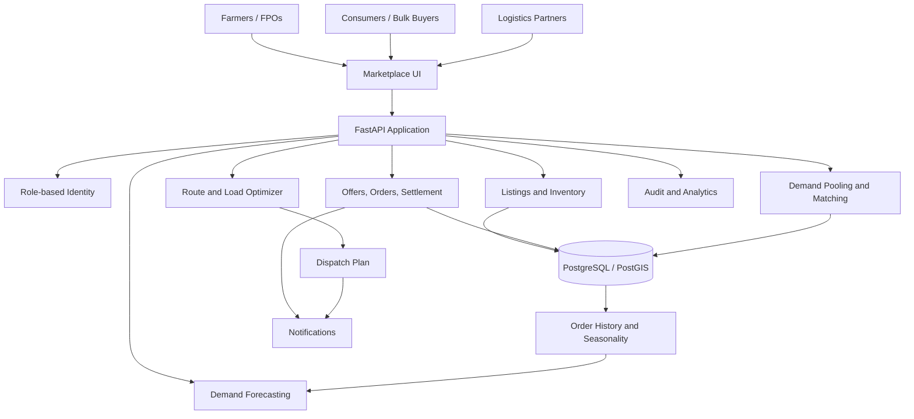
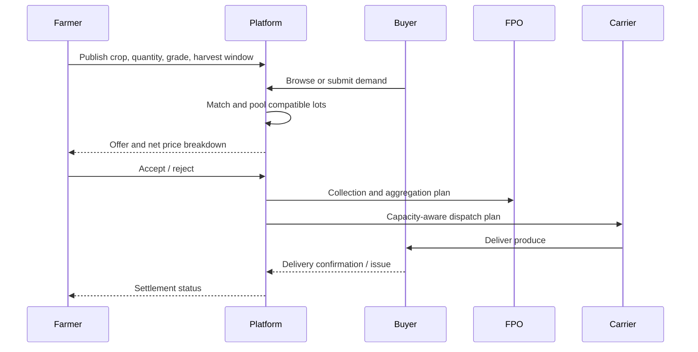

# Smart India Hackathon Workshop
**Date:** 7 November 2026  
**Reference Number:** 26011448
**Name:** Sachin.G

## Problem Title
Multiple intermediaries reduce farmers' earnings and increase consumer prices.

## Problem Creator's Organization
Ministry of Consumer Affairs, Food & Public Distribution

## Theme
Agriculture, FoodTech & Rural Development

## Problem Description
Multiple intermediaries between farmers and buyers can reduce producer price realization and increase consumer prices. The brief calls for a digital marketplace connecting farmers/FPOs with consumers and bulk buyers, logistics support, and AI-based demand forecasting and route optimization.

## Proposed Solution — KisanSetu Direct
KisanSetu Direct is a farmer-first marketplace for transparent produce listings, pooled demand, coordinated logistics, and traceable order fulfillment.

### Workflow
1. Farmers/FPOs register crops, quantity, quality grade, harvest window, location, and minimum acceptable net price.
2. Buyers (consumers, retailers, hotels, institutions) browse listings or post demand.
3. The platform matches by crop, grade, quantity, location, and freshness window.
4. Compatible orders are pooled into buyer-ready lots; farmers see buyer price, logistics costs, and any platform fee separately.
5. Farmers accept or reject offers. A price-floor alert flags offers below their chosen minimum net price.
6. FPO collection points aggregate produce. Logistics planning accounts for vehicle capacity, distance, time windows, and perishability.
7. Orders track accepted, aggregated, picked up, delivered, and settled states. Proof of delivery and dispute handling improve trust.
8. Demand forecasting estimates crop/region demand using transaction history and seasonality; forecast confidence is shown.

### How it addresses the problem
- Enables direct producer-to-buyer transactions, reducing opaque intermediary layers.
- Pools smallholder quantities to fulfill bulk demand.
- Improves price transparency through a net-price breakdown.
- Signals demand ahead of harvest, helping reduce unsold surplus.
- Consolidates deliveries to reduce per-unit transport costs and spoilage.

### Innovation and uniqueness
- Harvest-window and freshness-aware matching.
- FPO-first aggregation enabling small farms to participate in institutional orders.
- Explainable buyer/route recommendations (quantity fit, distance, freshness, capacity, time).
- Farmer-controlled minimum net price guardrail.
- Local-language, mobile-first, assisted onboarding and low-bandwidth friendly UX.
- Waste-aware prioritization for lots approaching freshness deadlines.

## Technical Approach
A modular MVP web app with REST APIs, PostgreSQL data storage, deterministic matching, and an optimization service. ML complexity grows only after sufficient reliable data is collected.

### Proposed stack
- Frontend: React + TypeScript responsive/PWA.
- Backend: Python FastAPI REST API.
- Database: PostgreSQL; PostGIS for geo queries.
- Forecasting: Python, pandas, scikit-learn; start seasonal-naive/moving-average baseline and measure MAE/WAPE.
- Routing: Google OR-Tools for capacity and time-window vehicle routing; heuristic fallback.
- Auth: secure role-based access for farmer, buyer, FPO, and logistics users.
- Notifications: configurable SMS/email/push service.
- Deployment: Docker, TLS, managed database, backups, monitoring.

### Architecture diagram

### Implementation process
1. Model users, crop catalog, grades, units, listings, buyer demand, orders, vehicles, routes, and settlement.
2. Build onboarding, produce listing CRUD, search and filters.
3. Implement offers, order confirmation, inventory reservation, and status tracking.
4. Pool orders compatible by crop, grade, region, and time.
5. Plan delivery routes subject to capacity and time windows.
6. Integrate baseline forecasting with confidence and horizon labels.
7. Test role permissions, stock concurrency, invalid quantities, cancellation, disputes, and delivery exceptions.
8. Pilot with an FPO and buyers; evaluate measured outcomes.

### Order and logistics sequence

## Feasibility and Viability
### Feasibility
Listings, order workflows, and access control are established web-app patterns. Routing libraries support capacity/time-window constraints. Forecasting is feasible as a baseline, though dependable accuracy requires normalized transaction data and sufficient local history. Modular design enables incremental payment, market-price, and carrier integrations.

### Risks and mitigations
| Risk | Mitigation |
|---|---|
| Digital literacy/adoption | Local language, assisted FPO onboarding, simple flows |
| Crop grades and unit inconsistency | Standard catalog, unit normalization, quality checklist |
| Trust and quality disputes | Listing evidence, clear terms, proof of delivery, documented dispute process |
| Forecast cold start | Seasonal baseline and buyer pre-orders; display confidence |
| Perishability and delays | Freshness-aware matching, time-window routing, exception alerts |
| Carrier capacity shortage | Collection hubs, multiple carriers, confirm capacity before order lock |
| Data privacy/security | Least privilege, encryption, audit trail, retention controls |
| Price volatility | Farmer-set price floor, timestamped reference prices, clear cost components |

### Viability
Potential revenue: transparent transaction fee, optional logistics coordination fee, or institutional buyer subscription. Pilot unit economics must be validated and fees must be disclosed before farmer acceptance.

## Impact and Benefits
### Target audience
Small/marginal farmers, FPOs, consumers, retailers, hotels, institutional buyers, logistics providers.

### Benefits
- **Economic:** improved producer price realization potential, transparent price comparisons, reduced per-unit logistics expense.
- **Social:** broader market access and inclusion through assisted/local-language onboarding.
- **Environmental:** fewer partially loaded trips and reduced food loss via freshness/demand matching.
- **Operational:** traceable orders and stronger demand signals for harvest planning.

### Pilot metrics
Farmer net price versus comparable baseline; buyer landed price; share of quantity sold and spoilage; fulfillment and on-time rates; dispute rate; logistics cost/kg and vehicle utilization; forecast MAE/WAPE; farmer retention and repeat buyer rate. Establish targets only after baseline measurement—no unsupported impact claims.

## Research and References
1. SIH-26033 workshop problem brief, Ministry of Consumer Affairs, Food & Public Distribution.
2. FAO, The State of Food and Agriculture: https://www.fao.org/publications/sofa/
3. FAO, Food Loss and Food Waste: https://www.fao.org/food-loss-and-food-waste/
4. Government of India e-NAM: https://www.enam.gov.in/
5. Google OR-Tools optimization: https://developers.google.com/optimization
6. PostGIS: https://postgis.net/
7. scikit-learn: https://scikit-learn.org/stable/

## Scope and limitations
This is an MVP proposal; forecasting quality, farmer price impact, delivery savings, and adoption must be validated in a pilot. The platform does not guarantee price increases or remove all intermediary services; aggregation and logistics partners may remain valuable.
